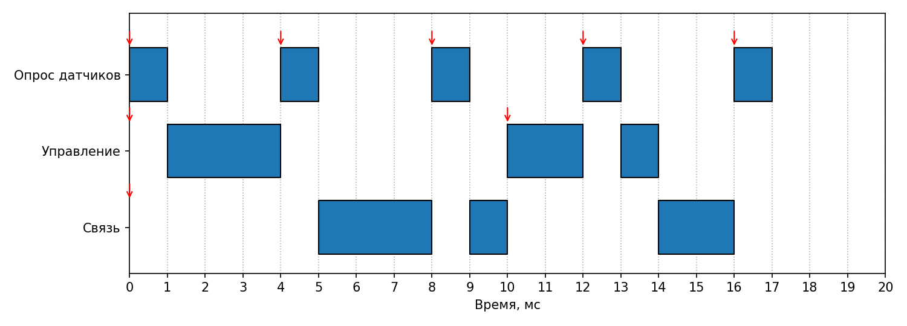

# Планирование периодических задач: RMS и EDF


Практическая работа №3 по дисциплине «Системы реального времени».

Консольное приложение на Python, которое по набору периодических задач проверяет планируемость методами
**Rate Monotonic (RMS)** и **Earliest Deadline First (EDF)**, вычисляет время отклика каждой задачи
и строит временную диаграмму выполнения по RMS на интервале до гиперпериода.

**Вариант 2: бортовая система** (опрос датчиков, управление, связь).

---

## Содержание

- [Функциональные возможности](#функциональные-возможности)
- [Краткие теоретические сведения](#краткие-теоретические-сведения)
- [Входные данные](#входные-данные)
- [Пример работы](#пример-работы)
- [Проверка на контрольном примере](#проверка-на-контрольном-примере)
- [Архитектура проекта](#архитектура-проекта)
- [Сборка и запуск](#сборка-и-запуск)
- [Автор](#автор)

---

## Функциональные возможности

- **Модель задачи** (имя, C, T, D) оформлена через `@dataclass`
- **Приоритеты RMS** назначаются автоматически: меньший период — выше приоритет
- **Коэффициент загрузки** `U = Σ Cᵢ/Tᵢ`
- **Утилизационный тест Liu & Layland** для RMS
- **Тест EDF** `U ≤ 1` для неявных дедлайнов (D = T)
- **Анализ времени отклика** по рекуррентной формуле, с выводом всех шагов итерации
- **Проверка дедлайна** для каждой задачи
- **Временная диаграмма** выполнения по RMS на интервале `[0, гиперпериод]` в консоли
  и картинкой PNG (если установлен `matplotlib`)
- **Исходные данные** читаются из JSON-файла, в коде нет «магических чисел»
- **Проверка данных** при загрузке: нецелые или неположительные C, T, D, дедлайн больше периода, пустой набор

---

## Краткие теоретические сведения

| Величина | Формула |
|----------|---------|
| Загрузка процессора | `U = Σ Cᵢ / Tᵢ` |
| Граница Liu & Layland | `U_LL(n) = n·(2^(1/n) − 1)`; при n → ∞ стремится к ln 2 ≈ 0,693 |
| Тест RMS (достаточный) | `U ≤ U_LL(n)` |
| Тест EDF (D = T, необходимый и достаточный) | `U ≤ 1` |
| Время отклика (итерация) | `R⁽ᵏ⁺¹⁾ = Cᵢ + Σ_{j ∈ hp(i)} ⌈R⁽ᵏ⁾ / Tⱼ⌉ · Cⱼ`, `R⁽⁰⁾ = Cᵢ` |
| Гиперпериод | `H = НОК(T₁, …, Tₙ)` |

Итерация останавливается, когда `R⁽ᵏ⁺¹⁾ = R⁽ᵏ⁾` (найдено время отклика) или когда `R` превысил дедлайн `D`
(задача не успевает).

Тест Liu & Layland только **достаточный**: если он не пройден, набор всё ещё может быть планируем —
точный ответ даёт анализ времени отклика. Именно такой случай и получился в варианте 2.

---

## Входные данные

Данные варианта лежат в `data/variant2.json`. Все времена в миллисекундах.

```json
{
    "title": "бортовая система (датчики, управление, связь)",
    "tasks": [
        {"name": "Опрос датчиков", "C": 1, "T": 4, "D": 4},
        {"name": "Управление", "C": 3, "T": 10, "D": 10},
        {"name": "Связь", "C": 6, "T": 20, "D": 20}
    ]
}
```

| Поле | Описание |
|------|----------|
| `title` | Название системы (выводится в заголовке) |
| `tasks[].name` | Название задачи |
| `tasks[].C` | Время выполнения в худшем случае (WCET), мс |
| `tasks[].T` | Период, мс |
| `tasks[].D` | Относительный дедлайн, мс (D ≤ T) |

---

## Пример работы

```
Анализ планируемости: бортовая система (датчики, управление, связь)

Пр. | Задача         |   C |    T |    D |   C/T |    R | Уложилась
-------------------------------------------------------------------
  1 | Опрос датчиков |   1 |    4 |    4 |  0.25 |    1 | да
  2 | Управление     |   3 |   10 |   10 |   0.3 |    4 | да
  3 | Связь          |   6 |   20 |   20 |   0.3 |   16 | да
-------------------------------------------------------------------
Пр. - приоритет RMS (1 - наивысший, меньший период - выше приоритет)

ЗАГРУЗКА ПРОЦЕССОРА
U = 0.25 + 0.3 + 0.3 = 0.85

RMS: УТИЛИЗАЦИОННЫЙ ТЕСТ LIU & LAYLAND
Граница для n = 3: n·(2^(1/n) - 1) = 0.78
U = 0.85 > 0.78 - тест не пройден. Тест достаточный, поэтому вывод делаем по анализу времени отклика.

RMS: АНАЛИЗ ВРЕМЕНИ ОТКЛИКА
Опрос датчиков: R = 1 -> 1; R = 1 <= D = 4 - укладывается
Управление: R = 3 -> 4 -> 4; R = 4 <= D = 10 - укладывается
Связь: R = 6 -> 11 -> 15 -> 16 -> 16; R = 16 <= D = 20 - укладывается
Вывод: все задачи укладываются в дедлайны, набор планируем по RMS.

EDF
U = 0.85 <= 1 - набор планируем по EDF.

Гиперпериод (НОК периодов) = 20 мс

ДИАГРАММА ВЫПОЛНЕНИЯ ПО RMS на [0, 20] мс
Время, мс      0         5         10        15        20        
Опрос датчиков ██· · · ██· · · ██· · · ██· · · ██· · · 
Управление     · ██████· · · · · · ████· ██· · · · · · 
Связь          · · · · · ██████· ██· · · · ████· · · · 
Простой процессора: 3 из 20 мс
Пропусков дедлайнов на гиперпериоде нет.
```

Загрузка `U = 0,85` больше границы Liu & Layland `0,78`, поэтому утилизационный тест не пройден.
Но анализ времени отклика показывает, что все задачи укладываются в дедлайны (`R = 1, 4, 16`),
и диаграмма на гиперпериоде 20 мс подтверждает это — набор планируем по RMS. По EDF `U = 0,85 ≤ 1` — тоже планируем.



---

## Проверка на контрольном примере

Набор из методички лежит в `data/example_methodichka.json`:

```
python src/main.py data/example_methodichka.json
```

```
Анализ планируемости: набор из трёх задач (пример из методички)

Пр. | Задача |   C |    T |    D |   C/T |    R | Уложилась
-----------------------------------------------------------
  1 | τ1     |   1 |    4 |    4 |  0.25 |    1 | да
  2 | τ2     |   2 |    6 |    6 | 0.333 |    3 | да
  3 | τ3     |   1 |    8 |    8 | 0.125 |    4 | да
-----------------------------------------------------------
Пр. - приоритет RMS (1 - наивысший, меньший период - выше приоритет)

ЗАГРУЗКА ПРОЦЕССОРА
U = 0.25 + 0.333 + 0.125 = 0.708

RMS: УТИЛИЗАЦИОННЫЙ ТЕСТ LIU & LAYLAND
Граница для n = 3: n·(2^(1/n) - 1) = 0.78
U = 0.708 <= 0.78 - тест пройден, набор планируем по RMS.

RMS: АНАЛИЗ ВРЕМЕНИ ОТКЛИКА
τ1: R = 1 -> 1; R = 1 <= D = 4 - укладывается
τ2: R = 2 -> 3 -> 3; R = 3 <= D = 6 - укладывается
τ3: R = 1 -> 4 -> 4; R = 4 <= D = 8 - укладывается
Вывод: все задачи укладываются в дедлайны, набор планируем по RMS.

EDF
U = 0.708 <= 1 - набор планируем по EDF.

Гиперпериод (НОК периодов) = 24 мс

ДИАГРАММА ВЫПОЛНЕНИЯ ПО RMS на [0, 24] мс
Время, мс 0         5         10        15        20        
τ1        ██· · · ██· · · ██· · · ██· · · ██· · · ██· · · 
τ2        · ████· · · ████· · · · · ████· · · ████· · · · 
τ3        · · · ██· · · · · ██· · · · · · · ██· · · · · · 
Простой процессора: 7 из 24 мс
Пропусков дедлайнов на гиперпериоде нет.
```

Результаты совпадают с ожидаемыми в задании: `U ≈ 0,708 ≤ 0,780`, `R = 1, 3, 4`, все задачи укладываются,
по EDF набор планируем.

---

## Архитектура проекта

```
rts-lab3/
├── src/
│   ├── main.py       # точка входа: загрузка, анализ, диаграмма
│   ├── models.py     # @dataclass Task, чтение и проверка JSON
│   ├── analysis.py   # utilization, liu_layland_bound, rms_schedulable,
│   │                 # edf_schedulable, response_time, hyperperiod
│   ├── gantt.py      # gantt (моделирование RMS), вывод диаграммы, PNG
│   └── output.py     # таблица задач и заключение
├── data/
│   ├── variant2.json            # вариант 2: бортовая система
│   └── example_methodichka.json # контрольный пример из задания
└── docs/                        # отчёт и картинки диаграмм
```

---

## Сборка и запуск

Нужен Python 3.9 или новее. Сторонние библиотеки не нужны; `matplotlib` нужен только для сохранения диаграммы в PNG.

```
python src/main.py                                # вариант 2
python src/main.py data/example_methodichka.json  # контрольный пример
```

В Visual Studio: `src/main.py` → **Set as Startup File** → **Ctrl+F5**.
Другой файл данных — **Project → Properties → Debug → Script Arguments**.

---

## Автор

Ростовцев Д. А., группа Б.ИВТ.ПРОМ.23.01, ТвГТУ, 2026
